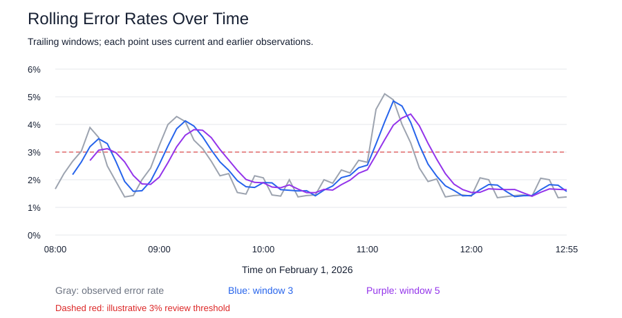

# Monitoring Reliability with Rolling Error Rates

Continuous Intelligence | Project 04 | Darrion Maurice Stringer

Author: Darrion Maurice Stringer
Date: 2026-11

## Overview

I investigated how rolling error rates can reveal periods of worsening system reliability.

My custom analysis compares windows of 3 and 5 observations. I wanted to understand how window size affects smoothing and how quickly a monitoring signal reflects a change.

## Data

I used the provided system metrics dataset containing 60 observations recorded five minutes apart on February 1, 2026, from 08:00 through 12:55.

Each observation includes:

- timestamp: time of observation.
- requests: number of requests handled.
- errors: number of failed requests.
- total_latency_ms: total response time in milliseconds.

[View Dataset](https://github.com/dstringer03/cintel-04-rolling-monitoring-custom/blob/main/data/system_metrics_timeseries.csv)

## Methods

I used Python and Polars to sort observations by timestamp and calculate an error-rate percentage for each observation:

    error_rate_pct = errors / requests × 100

I then calculated trailing rolling averages of those percentages using windows of 3 and 5 observations.

Each window includes the current observation and earlier observations only. No future values are included.

These are simple averages of observation-level error rates. They give each observation equal weight, rather than weighting by its request count.

The first 2 rows have no complete three-observation average. The first 4 rows have no complete five-observation average.

### Data Checks

The script checks for:

- Required columns and missing values.
- Duplicate timestamps.
- Negative request or error counts.
- Error counts greater than request counts.

Zero-request observations receive a null error rate rather than being treated as having no errors. The supplied dataset has no zero-request observations.

### Review Threshold

I used an illustrative threshold of greater than 3% to identify rolling values requiring review.

This threshold is an analytical choice for the assignment, not an established service standard.

## D2 Experiment

I changed the original pipeline's window size from 3 to 5.

I predicted more smoothing, slower responses, and four initial rows without rolling averages.

The results matched the expected initial blank rows. At 08:20, the rolling request average was 165 for window 3 and 150 for window 5. Including earlier, lower request counts made the larger window reflect the increase more slowly.

[Read the D2 Experiment](https://github.com/dstringer03/cintel-04-rolling-monitoring-custom/blob/main/README.md#d2-experiment-comparing-window-sizes)

## D3 Results

| Measure | Window 3 | Window 5 |
|---|---:|---:|
| Complete rolling windows | 58 | 56 |
| Peak rolling error rate | 4.85% | 4.37% |
| Time of peak | 11:15 | 11:25 |
| Observations above 3% | 15 | 14 |

The counts above the threshold refer to individual observation times, not separate incidents. Consecutive flagged observations can belong to the same period of concern.

[View Rolling Reliability Signals](https://github.com/dstringer03/cintel-04-rolling-monitoring-custom/blob/main/artifacts/rolling_reliability.csv)

[View Reliability Summary](https://github.com/dstringer03/cintel-04-rolling-monitoring-custom/blob/main/artifacts/reliability_summary.csv)

## Interpretation

The strongest rolling error-rate peak occurred during the 11:00 hour.

Window 3 peaked at approximately 4.85% at 11:15. Window 5 peaked at approximately 4.37% at 11:25.

The larger window produced a lower peak that appeared 10 minutes later. This illustrates how smoothing can delay the response to changing conditions.

For this project, I would choose window 3 for quicker review of worsening reliability. Window 5 provides useful context when I want a smoother view.

Error rates also provide more context than error counts alone because they account for the number of requests in each observation.

## Limitations

- The analysis covers only 60 observations from one day.
- The 3% review threshold has not been validated against service requirements.
- Rolling averages may hide brief spikes and delay detection.
- Observation-level rates are equally weighted despite different request counts.
- The data does not explain why error rates changed.
- The analysis generates review flags, not a live alerting system.
- The example reactive app is separate from this custom analysis.

## Next Steps

I would collect more days of data, investigate the flagged periods, and compare the results with actual service requirements.

I would also compare simple rolling averages with request-weighted rolling error rates and evaluate which method provides more useful warnings.

## Run the Project

From the project root, run the original rolling-metrics pipeline:

    uv run python -m cintel.rolling_monitor

The original pipeline currently uses the five-observation window selected in D2.

Run my custom reliability analysis:

    uv run python -m cintel.reliability_monitor

The custom script saves:

- artifacts/rolling_reliability.csv
- artifacts/reliability_summary.csv
- docs/images/rolling-reliability.svg

## Verification

The custom script ran successfully and generated the signals, summary, and chart.

The number of complete windows matched the expected calculations:

- Window 3: 60 - 3 + 1 = 58.
- Window 5: 60 - 5 + 1 = 56.

## Project Links

- [My GitHub Repository](https://github.com/dstringer03/cintel-04-rolling-monitoring-custom)
- [Custom Analysis Code](https://github.com/dstringer03/cintel-04-rolling-monitoring-custom/blob/main/src/cintel/reliability_monitor.py)
- [Results and Artifacts](https://github.com/dstringer03/cintel-04-rolling-monitoring-custom/tree/main/artifacts)

## Documentation Index

- [Project Instructions](project-instructions.md)
- [Glossary](glossary.md)
- [API](api.md)
- [Reactive App](./app/index.html)

## Resources

Based on the example project by Denise Case.

- [Original Example Repository](https://github.com/denisecase/cintel-04-rolling-monitoring)
- [Professional Python Guide](https://denisecase.github.io/pro-analytics-02/)
